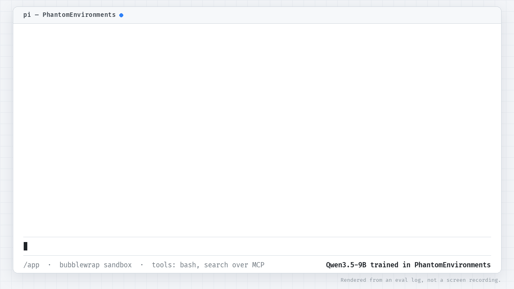
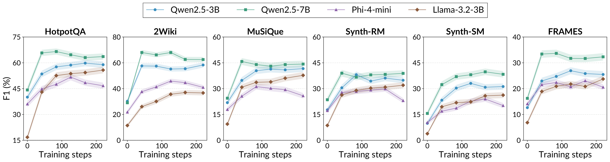

# PhantomEnvironments

**[PhantomEnvironments: Training LLM Agents in Fictional Worlds](https://arxiv.org/abs/2609.40221)**

[](https://arxiv.org/abs/2609.40221)
[](https://huggingface.co/collections/kilian-group/phantom-environments-6ad68ec75e111b426ba8bf24)

PhantomEnvironments generates synthetic RL environments that train LLMs as search agents. Each
environment is a "fictional world": a fictional Wikipedia with questions about it. The generator
runs cheaply on CPUs, distills from no other model, and computes every answer itself, so each task is
fully verifiable. Agents trained in these fictional worlds transfer to real-world agentic search.

<p align="center">
  
</p>

<p align="center">
  
</p>

Each environment is a fictional universe of people. The generator writes one article per person and
asks questions whose answers it computes from the universe's facts. For each question, the agent
searches the articles and reads what comes back, and the environment rewards its final answer. For
instance, you can train an LLM in the [pi](https://pi.dev) agent harness, where it finds the articles
with a search tool over MCP.

## News

- **2026-Nov-22:** Generate environments in pure Python, without SWI-Prolog: a universe of 1M people
  takes 1.5 minutes. Friendships are sparser by default (0.5 friends per person, down from 3), so that
  questions keep few answers; pass `--friendship_degree 3` for the earlier universes.
- **2026-Nov-20:** [Train Qwen3.5-9B in the pi harness with a search tool](examples/train_pi_search_qwen35-9b.sh)
  served over MCP, improving F1 score from 56% to 66%. The agent learns to run several searches per turn.
  On an 8xH100 node, training took 13 hours.
- **2026-Nov-19:** [Fine-tune Inkling 2 Small with Tinker](examples/train_inkling_tinker.sh) in the pi harness,
  improving F1 score from 65% to 75% (Qwen4-Max: 69%). Training cost ~$145 on Tinker and took 6 hours.
- **2026-Nov-19:** [Train Qwen3.5-9B in the pi harness](examples/train_pi_qwen35-9b.sh), with bash in a
  sandbox, improving F1 score from 46% to 62% (Qwen4-Max: 69%). On an 8xH100 node, training took 15
  hours (see [visualization](assets/terminal-agent.gif)).
- **2026-Nov-17:** [Train Qwen3.5-9B in a coding agent harness](examples/train_shell_qwen35-9b.sh) to search
  using bash commands, improving F1 score from 50% to 63% (Qwen4-Max: 65%). On an 8xH100 node, training
  took 11 hours.
- **2026-Nov-13:** Move to SkyRL Megatron backend support.
  [Train Qwen3-30B-A3B MoE on PhantomWiki](examples/train_pw_qwen3-30b.sh) to improve agentic search
  F1 score from 46% to 56%. On an 8xH100 node, training took 40 hours.

## Installation

```bash
curl -LsSf https://astral.sh/uv/install.sh | sh

# `--extra skyrl` installs what training agents needs; omit it to only generate environments
uv sync --extra skyrl
cp .env.example .env

# The terminal style runs each episode in a bubblewrap sandbox
sudo apt-get install -y bubblewrap

# Build the sandbox's image (bash, Python and the pi agent) with Docker and export its files to a
# new dir. Then tell the sandbox where they are: set SANDBOX_ROOTFS=<dir> in .env
bash scripts/sandbox/build_rootfs.sh <dir>
```

## Quick start

### 1. Generate an environment

```bash
uv run phantom_envs generate --preset pw --output_dir data/envs/pw
```

There are three presets:

- `pw` (**Hops**): *"What is the hobby of the parent of Eddie Caruthers?"*
- `pwcons` (**Hops+Constraints**): *"Who is the friend of the person whose occupation is editor?"*
- `pwcomp` (**Hops+Comparisons**): *"Who is older, the child of Curt Hulbert or the sister of Kareem Finger?"*

Settings after the flags override the preset:

```bash
uv run phantom_envs generate \
    --preset pwcons \
    --output_dir data/envs/pwcons-custom \
    size=5000 \
    seed=2 \
    max_hops=4 \
    'kinds=[base,count]'
```

- `size`, `seed`: the number of people in the universe, and its seed.
- `max_hops`, `max_constraints`: the hardest questions.
- `kinds`: `base`, `count` ("How many ...") and `comparison` questions.
- `hard_mode=true`: relations that span several articles, like `cousin`.
- `friendship_degree`: the average number of friends per person (also `--friendship_degree`). Above
  about 1, questions over several hops get many answers.
- `rewrite_docs_with_llm=openai/gpt-6-luna`: rewrite the template articles as Wikipedia-style
  biographies with the same facts, using that model on OpenRouter (set `OPENROUTER_API_KEY`).

`EnvConfig` in `src/phantom_envs/_types.py` lists every setting. The same from Python:

```python
import dataclasses
import phantom_envs

config = dataclasses.replace(phantom_envs.PRESETS["pwcons"], size=2000, seed=3)
env = phantom_envs.generate("data/envs/pwcons-seed3", config)
print(env.tasks("train")[0])
```

An environment dir holds `phantom_env.json` (the config and a content hash), `universe/` (the
facts and articles), `corpus.jsonl` (the articles the agent searches) and `tasks/{train,validation}.jsonl`
(the questions and answers).

### 2. Build the retrieval indexes

The Search-R1 style agent and the terminal agent's search tool find the articles with a dense
retriever: e5 while training, Qwen3-Embedding-4B for evaluation. A terminal agent with only bash reads
the articles as files and needs no index.

```bash
# For training (e5-base-v2)
uv run --with faiss-cpu==1.12.0 python -m phantom_envs.retriever.build_index \
    --data_dir data/envs/pw

# For evaluation (Qwen3-Embedding-4B)
uv run --with faiss-cpu==1.12.0 python -m phantom_envs.retriever.build_index \
    --data_dir data/envs/pw \
    --encoder qwen3-4b
```

### 3. Train

#### Search-R1 style

```bash
uv run python scripts/skyrl/prepare_data.py --data_dir data/envs/pw   # tasks -> SkyRL parquets
bash scripts/skyrl/launch_skyrl.sh train e5 data/envs/pw
```

The launcher starts the retrieval server, then trains with the Megatron backend of
[SkyRL](https://github.com/novasky-ai/SkyRL) on every GPU in `CUDA_VISIBLE_DEVICES` (default: all),
and saves checkpoints under `$RUN_BASE_DIR`. The default config (`scripts/skyrl/configs/base.yaml`)
trains Qwen2.5-3B-Instruct, and we tuned it for 2 B200s. Model configs in
`scripts/skyrl/configs/models/` and overrides stack on top:

```bash
bash scripts/skyrl/launch_skyrl.sh train e5 data/envs/pw \
    --config scripts/skyrl/configs/models/Llama-3.2-3B-Instruct.yaml \
    trainer.seed=2
```

#### Terminal style

Train on an environment whose articles an LLM has rewritten (`rewrite_docs_with_llm` in step 1). Write
the terminal parquets, then pass `terminal` in place of the encoder and `--search=e5` for the search
tool. Each episode runs pi in its own bubblewrap sandbox with bash and a search tool. The articles are
not on disk, so the agent searches for them, and it writes its answer to `/app/output.md`.
[examples/train_pi_search_qwen35-9b.sh](examples/train_pi_search_qwen35-9b.sh) runs all of it end to end.

```bash
# Set CUDA_HOME in .env so that Qwen3.5 kernels get compiled for fast training
uv run phantom_envs generate --preset pw --output_dir data/envs/pw-rewrite rewrite_docs_with_llm=openai/gpt-6-luna
uv run python scripts/skyrl/prepare_data.py --data_dir data/envs/pw-rewrite --env terminal
uv run --with faiss-cpu==1.12.0 python -m phantom_envs.retriever.build_index --data_dir data/envs/pw-rewrite
bash scripts/skyrl/launch_skyrl.sh train terminal data/envs/pw-rewrite --search=e5 \
    --config scripts/skyrl/configs/models/Qwen3.5-9B.yaml \
    trainer.train_batch_size=128 \
    trainer.policy_mini_batch_size=128 \
    trainer.max_tokens_per_microbatch=12288 \
    trainer.hf_save_interval=20
```

The search server runs on the first GPU beside the trainer. We paused the run at the step 100
checkpoint when `pw` validation saturated near 100%.

### 4. Evaluate

`scripts/benchmarks/` builds the real-world benchmarks in the same data-dir layout; see
[reproduce_paper/README.md](reproduce_paper/README.md).

#### Search-R1 style

Our trained checkpoints are on Hugging Face:
[`kilian-group/PhantomEnvs-Qwen2.5-3B-Instruct`](https://huggingface.co/kilian-group/PhantomEnvs-Qwen2.5-3B-Instruct)
and [`kilian-group/PhantomEnvs-Qwen2.5-7B-Instruct`](https://huggingface.co/kilian-group/PhantomEnvs-Qwen2.5-7B-Instruct).

```bash
bash scripts/skyrl/launch_skyrl.sh eval qwen3-4b data/envs/pw \
    trainer.policy.model.path=kilian-group/PhantomEnvs-Qwen2.5-3B-Instruct \
    --out_dir=out__eval=pw
uv run python scripts/score_trajectories.py --eval_dir out__eval=pw --data_source pw
```

For your own runs, pass `trainer.policy.model.path=<run>/exports/global_step_<N>/policy`.

<p align="center">
  
  <br><em>F1 on real-world multi-hop benchmarks over training on Hops.</em>
</p>

#### Terminal style

Pass `terminal` and `--search=qwen3-4b` here too. Evals run on all 8 GPUs (the Qwen3.5-9B config runs 4
vLLM engines with tensor parallelism 2):

```bash
uv run python scripts/skyrl/prepare_data.py --data_dir data/hp500 --env terminal
uv run --with faiss-cpu==1.12.0 python -m phantom_envs.retriever.build_index --data_dir data/hp500 --encoder qwen3-4b
CUDA_VISIBLE_DEVICES=0,1,2,3,4,5,6,7 bash scripts/skyrl/launch_skyrl.sh eval terminal data/hp500 --search=qwen3-4b \
    --config scripts/skyrl/configs/models/Qwen3.5-9B.yaml \
    trainer.policy.model.path=<run>/exports/global_step_100/policy \
    --out_dir=out__eval=hp500__pi_search
uv run python scripts/score_trajectories.py --eval_dir out__eval=hp500__pi_search --data_source hp500
# The episodes as chats, with each search and bash call in turn, at http://127.0.0.1:8765
uv run python scripts/visualize_terminal_trajectories.py out__eval=hp500__pi_search
```

## Repository layout

```
src/phantom_envs/              environment generation, the search and terminal episodes, scoring, the retriever
scripts/skyrl/                 the SkyRL launcher, entrypoints, configs and data prep
scripts/tinker/                training and evals through the Tinker API, and their model configs
scripts/benchmarks/            real-world benchmarks as data dirs
scripts/score_trajectories.py  EM / F1 of dumped eval trajectories
scripts/sandbox/               the terminal style's sandbox image
scripts/harbor/                the questions as Harbor tasks, for coding agents like qwen-code in Docker
scripts/clusters/              running on Cornell's unicorn cluster
examples/                      end-to-end scripts: data, training and evals in one go
reproduce_paper/               the paper's data, runs, evals, tables and figures
```

## Reproducing the paper

[reproduce_paper/README.md](reproduce_paper/README.md) rebuilds the paper's datasets, training runs,
evaluations, tables and figures. The paper's experiments trained with SkyRL's FSDP backend: for their
library versions and experiments, use the repo's
[`paper`](https://github.com/kilian-group/phantom-envs/tree/paper) tag (`git checkout paper`).

## Citation

```bibtex
@article{kabra2026phantomenvironments,
  title={PhantomEnvironments: Training LLM Agents in Fictional Worlds},
  author={Kabra, Anmol and Selvam, Swathi Saravana and Gong, Albert and Wan, Chao and Belardi, Christian and Go, Dongyoung and Luo, Katie Z and Weinberger, Kilian Q},
  journal={arXiv preprint arXiv:2609.40221},
  year={2026}
}
```
