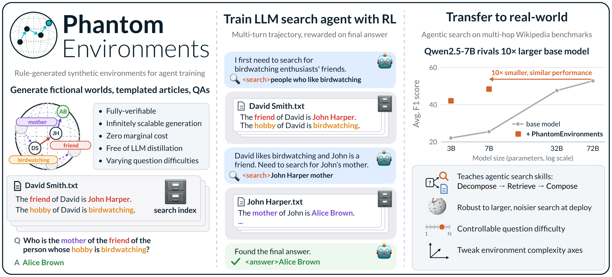
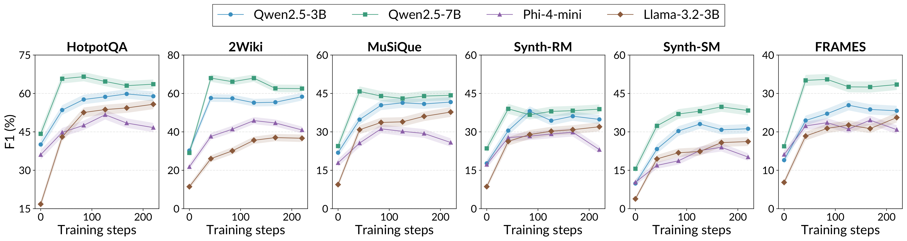

# PhantomEnvironments

**[PhantomEnvironments: Training LLM Agents in Fictional Worlds](https://arxiv.org/abs/2609.40221)**

[](https://arxiv.org/abs/2609.40221)
[](https://huggingface.co/collections/kilian-group/phantom-environments-6ad68ec75e111b426ba8bf24)

Rule-generated fictional worlds for training LLM search agents with reinforcement learning. Agents
trained in these worlds transfer to real-world multi-hop QA.

<p align="center">
  
</p>

Each environment is a fictional universe of people, written out as one article per person, plus
questions whose answers are computed by Prolog. The agent searches the articles with
`<search>query</search>`, reads the `<information>` that comes back, and ends with
`<answer>...</answer>`, rewarded on the final answer.

## Installation

```bash
# SWI-Prolog, to generate environments. On Ubuntu:
sudo add-apt-repository -y ppa:swi-prolog/stable && sudo apt-get install -y swi-prolog-nox
# ...or without root, in a conda env of its own (activate it while generating):
conda create -n swipl -c conda-forge swi-prolog && conda activate swipl

curl -LsSf https://astral.sh/uv/install.sh | sh
uv sync --extra skyrl   # without --extra skyrl: environment generation only
cp .env.example .env    # W&B and run dirs
```

## Quick start

### 1. Generate an environment

```bash
uv run phantom_envs generate --preset pw --output_dir data/envs/pw
```

There are three presets:

- `pw` (**Hops**): *"What is the hobby of the parent of Eddie Caruthers?"*
- `pwcons` (**Hops+Constraints**): *"Who is the friend of the person whose occupation is editor?"*
- `pwcomp` (**Hops+Comparisons**): *"Who is older, the child of Curt Hulbert or the sister of Kareem Finger?"*

Settings after the flags override the preset:

```bash
uv run phantom_envs generate \
    --preset pwcons \
    --output_dir data/envs/pwcons-custom \
    size=5000 \
    seed=2 \
    max_hops=4 \
    'kinds=[base,count]'
```

- `size`, `seed`: the number of people in the universe, and its seed.
- `max_hops`, `max_constraints`: the hardest questions.
- `kinds`: `base`, `count` ("How many ...") and `comparison` questions.
- `hard_mode=true`: relations that span several articles, like `cousin`.

`EnvConfig` in `src/phantom_envs/_types.py` lists every setting. The same from Python:

```python
import dataclasses
import phantom_envs

config = dataclasses.replace(phantom_envs.PRESETS["pwcons"], size=2000, seed=3)
env = phantom_envs.generate("data/envs/pwcons-seed3", config)
print(env.tasks("train")[0])
```

An environment dir holds `phantom_env.json` (the config and a content hash), `universe/` (the Prolog
facts and articles), `corpus.jsonl` (the articles the agent searches) and `tasks/{train,validation}.jsonl`
(the questions and answers).

### 2. Build the retrieval indexes

```bash
# For training (e5-base-v2)
uv run --with faiss-cpu==1.12.0 python -m phantom_envs.retriever.build_index \
    --data_dir data/envs/pw

# For evaluation (Qwen3-Embedding-4B)
uv run --with faiss-cpu==1.12.0 python -m phantom_envs.retriever.build_index \
    --data_dir data/envs/pw \
    --encoder qwen3-4b
```

### 3. Train

```bash
uv run python scripts/skyrl/prepare_data.py --data_dir data/envs/pw   # tasks -> SkyRL parquets
bash scripts/skyrl/launch_skyrl.sh train e5 data/envs/pw
```

The launcher starts the retrieval server, then trains with [SkyRL](https://github.com/novasky-ai/SkyRL)
on every GPU in `CUDA_VISIBLE_DEVICES` (default: all); checkpoints go under `$RUN_BASE_DIR`. The
default config trains Qwen2.5-3B-Instruct and is tuned for 2 B200s (`scripts/skyrl/configs/base.yaml`).
Model configs in `scripts/skyrl/configs/models/` and overrides stack on top:

```bash
bash scripts/skyrl/launch_skyrl.sh train e5 data/envs/pw \
    --config scripts/skyrl/configs/models/Llama-3.2-3B-Instruct.yaml \
    trainer.seed=2
```

### 4. Evaluate

Our trained checkpoints are on Hugging Face:
[`kilian-group/PhantomEnvs-Qwen2.5-3B-Instruct`](https://huggingface.co/kilian-group/PhantomEnvs-Qwen2.5-3B-Instruct)
and [`kilian-group/PhantomEnvs-Qwen2.5-7B-Instruct`](https://huggingface.co/kilian-group/PhantomEnvs-Qwen2.5-7B-Instruct).

```bash
bash scripts/skyrl/launch_skyrl.sh eval qwen3-4b data/envs/pw \
    trainer.policy.model.path=kilian-group/PhantomEnvs-Qwen2.5-3B-Instruct \
    --out_dir=out__eval=pw
uv run python scripts/score_trajectories.py --eval_dir out__eval=pw --data_source pw
```

For your own runs, pass `trainer.policy.model.path=<run>/exports/global_step_<N>/policy`.
`scripts/benchmarks/` builds the real-world benchmarks in the same data-dir layout; see
[reproduce_paper/README.md](reproduce_paper/README.md).

<p align="center">
  
  <br><em>F1 on real-world multi-hop benchmarks over training on Hops.</em>
</p>

## Repository layout

```
src/phantom_envs/              environment generation, the search protocol and reward, scoring, the retriever
scripts/skyrl/                 the SkyRL launcher, entrypoints, configs and data prep
scripts/benchmarks/            real-world benchmarks as data dirs
scripts/score_trajectories.py  EM / F1 of dumped eval trajectories
scripts/clusters/              running on Cornell's unicorn cluster
reproduce_paper/               the paper's data, runs, evals, tables and figures
```

## Reproducing the paper

[reproduce_paper/README.md](reproduce_paper/README.md) rebuilds the paper's datasets, training runs,
evaluations, tables and figures.

## Citation

```bibtex
@article{kabra2026phantomenvironments,
  title={PhantomEnvironments: Training LLM Agents in Fictional Worlds},
  author={Kabra, Anmol and Selvam, Swathi Saravana and Gong, Albert and Wan, Chao and Belardi, Christian and Go, Dongyoung and Luo, Katie Z and Weinberger, Kilian Q},
  journal={arXiv preprint arXiv:2609.40221},
  year={2026}
}
```
