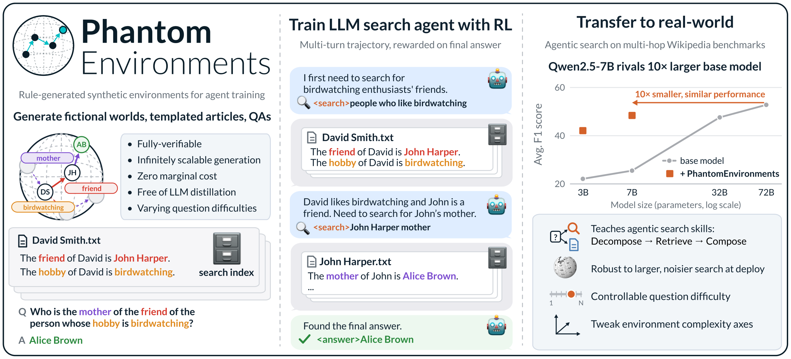

# PhantomEnvironments

**[PhantomEnvironments: Training LLM Agents in Fictional Worlds](https://arxiv.org/abs/2609.40221)**

[](https://arxiv.org/abs/2609.40221)
[](https://huggingface.co/collections/kilian-group/phantom-environments-6ad68ec75e111b426ba8bf24)

Rule-generated fictional worlds for training LLM search agents with reinforcement learning. Agents
trained in these worlds transfer to real-world multi-hop QA.

<p align="center">
  
</p>

Each environment is a fictional universe of people, written out as one article per person, plus
questions whose answers are computed by Prolog. The agent searches the articles with
`<search>query</search>`, reads the `<information>` that comes back, and ends with
`<answer>...</answer>`, rewarded on the final answer. Or, as a coding agent, it searches the articles
as files with bash and writes its answer to a file.

## New

- **Nov 2026:** [Train Qwen3.5-9B in a coding agent harness](examples/train_shell_qwen35-9b.sh) to search
  using bash commands, improving F1 score from 50% to 63% (Qwen4-Max: 65%). On an 8xH100 node, training
  took 11 hours.
- **Nov 2026:** Move to SkyRL Megatron backend support.
  [Train Qwen3-30B-A3B MoE on PhantomWiki](examples/train_pw_qwen3-30b.sh) to improve agentic search
  F1 score from 46% to 56%. On an 8xH100 node, training took 40 hours.

## Installation

```bash
# SWI-Prolog, to generate environments. On Ubuntu:
sudo add-apt-repository -y ppa:swi-prolog/stable && sudo apt-get install -y swi-prolog-nox
# ...or without root, in a conda env of its own (activate it while generating):
conda create -n swipl -c conda-forge swi-prolog && conda activate swipl

curl -LsSf https://astral.sh/uv/install.sh | sh
uv sync --extra skyrl   # without --extra skyrl: environment generation only
cp .env.example .env    # W&B and run dirs
```

## Quick start

### 1. Generate an environment

```bash
uv run phantom_envs generate --preset pw --output_dir data/envs/pw
```

There are three presets:

- `pw` (**Hops**): *"What is the hobby of the parent of Eddie Caruthers?"*
- `pwcons` (**Hops+Constraints**): *"Who is the friend of the person whose occupation is editor?"*
- `pwcomp` (**Hops+Comparisons**): *"Who is older, the child of Curt Hulbert or the sister of Kareem Finger?"*

Settings after the flags override the preset:

```bash
uv run phantom_envs generate \
    --preset pwcons \
    --output_dir data/envs/pwcons-custom \
    size=5000 \
    seed=2 \
    max_hops=4 \
    'kinds=[base,count]'
```

- `size`, `seed`: the number of people in the universe, and its seed.
- `max_hops`, `max_constraints`: the hardest questions.
- `kinds`: `base`, `count` ("How many ...") and `comparison` questions.
- `hard_mode=true`: relations that span several articles, like `cousin`.
- `rewrite_docs_with_llm=openai/gpt-6-luna`: rewrite the template articles as Wikipedia-style
  biographies with the same facts, using that model on OpenRouter (set `OPENROUTER_API_KEY`).

`EnvConfig` in `src/phantom_envs/_types.py` lists every setting. The same from Python:

```python
import dataclasses
import phantom_envs

config = dataclasses.replace(phantom_envs.PRESETS["pwcons"], size=2000, seed=3)
env = phantom_envs.generate("data/envs/pwcons-seed3", config)
print(env.tasks("train")[0])
```

An environment dir holds `phantom_env.json` (the config and a content hash), `universe/` (the Prolog
facts and articles), `corpus.jsonl` (the articles the agent searches) and `tasks/{train,validation}.jsonl`
(the questions and answers).

### 2. Build the retrieval indexes

Do this step for the search agent only. The coding agent does not require building an index.

```bash
# For training (e5-base-v2)
uv run --with faiss-cpu==1.12.0 python -m phantom_envs.retriever.build_index \
    --data_dir data/envs/pw

# For evaluation (Qwen3-Embedding-4B)
uv run --with faiss-cpu==1.12.0 python -m phantom_envs.retriever.build_index \
    --data_dir data/envs/pw \
    --encoder qwen3-4b
```

### 3. Train

#### Search-R1 style

```bash
uv run python scripts/skyrl/prepare_data.py --data_dir data/envs/pw   # tasks -> SkyRL parquets
bash scripts/skyrl/launch_skyrl.sh train e5 data/envs/pw
```

The launcher starts the retrieval server, then trains with the Megatron backend of
[SkyRL](https://github.com/novasky-ai/SkyRL) on every GPU in `CUDA_VISIBLE_DEVICES` (default: all);
checkpoints go under `$RUN_BASE_DIR`. The default config trains Qwen2.5-3B-Instruct and is tuned for 2
B200s (`scripts/skyrl/configs/base.yaml`).
Model configs in `scripts/skyrl/configs/models/` and overrides stack on top:

```bash
bash scripts/skyrl/launch_skyrl.sh train e5 data/envs/pw \
    --config scripts/skyrl/configs/models/Llama-3.2-3B-Instruct.yaml \
    trainer.seed=2
```

#### Coding agent style

Write the shell parquets and pass `shell` in place of the encoder. There is no retriever: each episode
runs in a [ShellSim](https://pypi.org/project/shellsim/) sandbox (a simulated bash) with the corpus as
files under `/corpus`, and the agent writes its answer to `/app/output.md`.
[examples/train_shell_qwen35-9b.sh](examples/train_shell_qwen35-9b.sh) runs it end to end.

```bash
# Set CUDA_HOME in .env so that Qwen3.5 kernels get compiled for fast training
uv run python scripts/skyrl/prepare_data.py --data_dir data/envs/pw --env shell
bash scripts/skyrl/launch_skyrl.sh train shell data/envs/pw \
    --config scripts/skyrl/configs/models/Qwen3.5-9B.yaml \
    trainer.train_batch_size=128 \
    trainer.policy_mini_batch_size=128 \
    trainer.hf_save_interval=40
```

The validation F1 score is near 100% by step 150, so the coding agent saturates the training data quickly. Seeing this saturation, we picked the step 120 checkpoint.

### 4. Evaluate

`scripts/benchmarks/` builds the real-world benchmarks in the same data-dir layout; see
[reproduce_paper/README.md](reproduce_paper/README.md).

#### Search-R1 style

Our trained checkpoints are on Hugging Face:
[`kilian-group/PhantomEnvs-Qwen2.5-3B-Instruct`](https://huggingface.co/kilian-group/PhantomEnvs-Qwen2.5-3B-Instruct)
and [`kilian-group/PhantomEnvs-Qwen2.5-7B-Instruct`](https://huggingface.co/kilian-group/PhantomEnvs-Qwen2.5-7B-Instruct).

```bash
bash scripts/skyrl/launch_skyrl.sh eval qwen3-4b data/envs/pw \
    trainer.policy.model.path=kilian-group/PhantomEnvs-Qwen2.5-3B-Instruct \
    --out_dir=out__eval=pw
uv run python scripts/score_trajectories.py --eval_dir out__eval=pw --data_source pw
```

For your own runs, pass `trainer.policy.model.path=<run>/exports/global_step_<N>/policy`.

<p align="center">
  
  <br><em>F1 on real-world multi-hop benchmarks over training on Hops.</em>
</p>

#### Coding agent style

Pass `shell` here too. Evals run on all 8 GPUs (the Qwen3.5-9B config runs 4 vLLM engines with tensor
parallelism 2):

```bash
uv run python scripts/skyrl/prepare_data.py --data_dir data/hp500 --env shell
CUDA_VISIBLE_DEVICES=0,1,2,3,4,5,6,7 bash scripts/skyrl/launch_skyrl.sh eval shell data/hp500 \
    --config scripts/skyrl/configs/models/Qwen3.5-9B.yaml \
    trainer.policy.model.path=<run>/exports/global_step_120/policy \
    --out_dir=out__eval=hp500__shell
uv run python scripts/score_trajectories.py --eval_dir out__eval=hp500__shell --data_source hp500
```

Use 16 GB memory for BrowseComp-Plus because the docs are long: add
`environment.skyrl_gym.phantom_shell.memory_gib=16`.

## Repository layout

```
src/phantom_envs/              environment generation, the search protocol and reward, scoring, the retriever
scripts/skyrl/                 the SkyRL launcher, entrypoints, configs and data prep
scripts/benchmarks/            real-world benchmarks as data dirs
scripts/score_trajectories.py  EM / F1 of dumped eval trajectories
scripts/harbor/                the questions as Harbor tasks, for coding agents like qwen-code in Docker
scripts/clusters/              running on Cornell's unicorn cluster
examples/                      end-to-end scripts: data, training and evals in one go
reproduce_paper/               the paper's data, runs, evals, tables and figures
```

## Reproducing the paper

[reproduce_paper/README.md](reproduce_paper/README.md) rebuilds the paper's datasets, training runs,
evaluations, tables and figures. The paper's experiments trained with SkyRL's FSDP backend: for their
library versions and experiments, use the repo's
[`paper`](https://github.com/kilian-group/phantom-envs/tree/paper) tag (`git checkout paper`).

## Citation

```bibtex
@article{kabra2026phantomenvironments,
  title={PhantomEnvironments: Training LLM Agents in Fictional Worlds},
  author={Kabra, Anmol and Selvam, Swathi Saravana and Gong, Albert and Wan, Chao and Belardi, Christian and Go, Dongyoung and Luo, Katie Z and Weinberger, Kilian Q},
  journal={arXiv preprint arXiv:2609.40221},
  year={2026}
}
```
